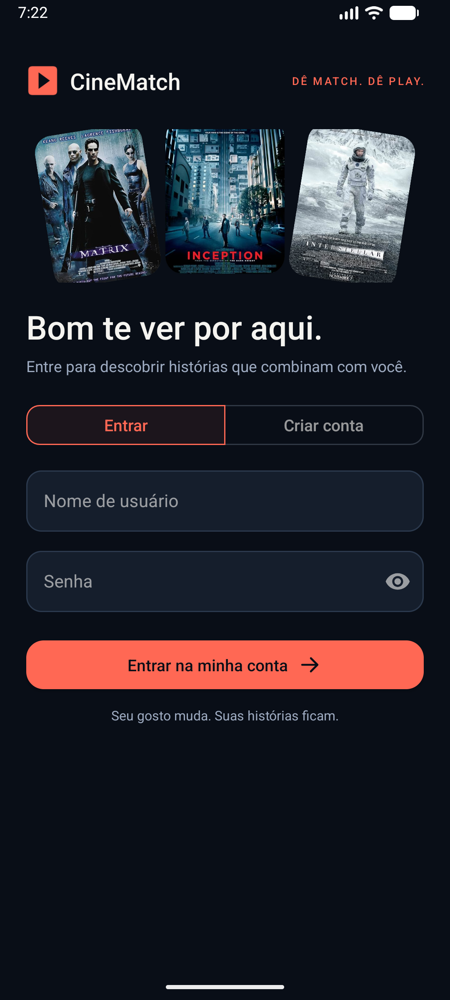
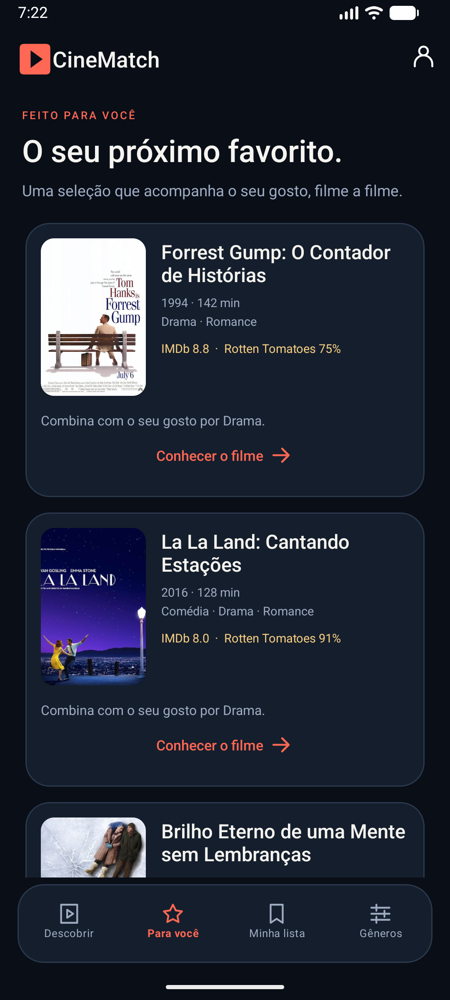
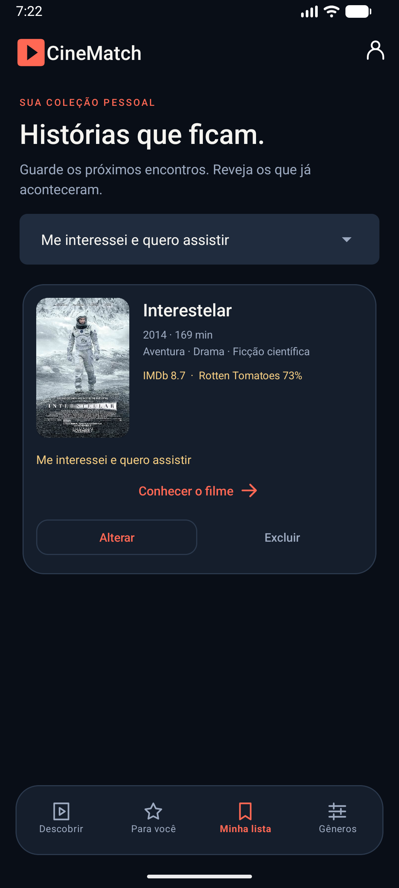
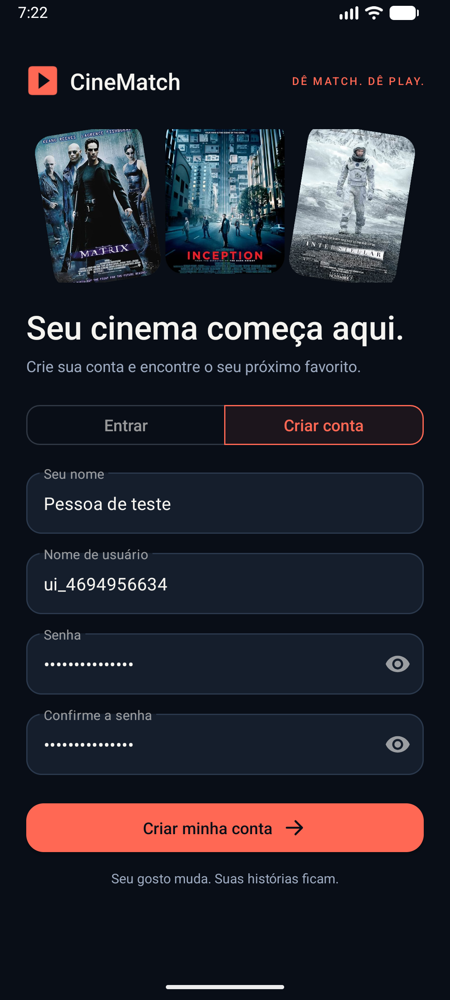

# CineMatch

Descubra sua próxima história. Aplicativo Android nativo para descobrir, avaliar e guardar filmes, com recomendações pessoais e **contas com nome de usuário e senha**. Projeto da AP2 de Desenvolvimento Mobile.

## Abrir e usar

No Android Studio, abra **`D:\movie-match\android`**, aguarde o Gradle Sync, selecione um emulador e execute a configuração `app` com ▶. O projeto usa o SDK 37 e o Gradle Wrapper incluído. O JDK integrado do Android Studio deste computador foi validado.

Na primeira abertura, toque em **Criar conta**. Informe nome, usuário (3–32 letras sem acentos, números, ponto, hífen ou sublinhado) e senha com pelo menos 8 caracteres. Depois escolha seus gêneros. Nas próximas entradas, use **Entrar** com o mesmo usuário e senha.

**O app abre no login e pede credenciais novamente ao retornar do segundo plano.** Senha e token não são persistidos no dispositivo; o token da sessão fica somente em memória. Navegação interna, rotação e o seletor de compartilhamento mantêm a sessão em uso. As preferências e avaliações continuam salvas na conta do backend. O ícone de pessoa no canto superior direito permite sair ou trocar de conta.

Perfis demonstrativos antigos, que não tinham senha, foram preservados no banco, mas não geram login automático nem são convertidos em contas com uma senha padrão. Crie uma conta para usar o novo fluxo.

## Backend no Windows

O backend precisa estar ligado enquanto o aplicativo é usado. O ambiente `.venv` já foi preparado neste computador. Para iniciar quando a API não estiver em execução:

```powershell
cd D:\movie-match
.\start-backend.ps1
```

Alternativa sem script PowerShell:

```powershell
cd D:\movie-match\backend
..\.venv\Scripts\python.exe -m uvicorn app.main:app --host 0.0.0.0 --port 8000
```

Para instalar em outro ambiente com Python 3.12+: ` .\setup.ps1 -Python 'C:\caminho\python.exe' `. Dependências Python fixadas em `backend/requirements.lock.txt`.

- [Swagger local](http://localhost:8000/docs)
- [OpenAPI](http://localhost:8000/openapi.json)
- [Verificação da API](http://localhost:8000/health)

O banco é `backend/cinematch.db`, criado automaticamente. Inicie a API a partir de `backend` ou use o script raiz para manter o mesmo arquivo. Não apague o banco para demonstrar persistência.

## Android e conexão

```powershell
cd D:\movie-match\android
.\build.ps1
# APK: app\build\outputs\apk\debug\app-debug.apk
```

Android mínimo: 8.0/API 26. O emulador padrão acessa o computador por **`http://10.0.2.2:8000/`**, já configurado em `BuildConfig.API_BASE_URL`. O `localhost` do Android é o próprio dispositivo.

Com `platform-tools` no PATH, para usar um celular USB com depuração autorizada:

```powershell
.\build.ps1 -ApiBaseUrl 'http://127.0.0.1:8000/'
adb reverse tcp:8000 tcp:8000
adb install -r app\build\outputs\apk\debug\app-debug.apk
```

HTTP é permitido somente no manifesto **debug**. Para distribuição de produção, use HTTPS, assinatura e a URL configurada por `-PAPI_BASE_URL=https://.../`.

## Interface e funcionalidades

- Login com cartazes reais, alternância entre entrar/cadastrar e validação dos campos.
- Preferências em cards selecionáveis, com contador e seleção múltipla.
- Descoberta com cartaz completo, fundo cinematográfico, título, duração, gêneros, IMDb, Rotten Tomatoes, sinopse expansível, elenco e compartilhamento.
- Quatro avaliações identificadas por texto, símbolo e cor: sem interesse, não gostei, quero assistir e gostei.
- Recomendações com motivos baseados nas preferências e avaliações da conta.
- Minha lista com filtro, atualização e exclusão das avaliações.
- Menu de conta e exigência de novo login ao reabrir.
- Layouts com largura máxima, listas em duas colunas em telas largas, painel lateral na horizontal e conteúdo rolável em telas pequenas.

### Cinco Activities e Intents

| Activity | Responsabilidade |
|---|---|
| MainActivity | Login/cadastro com usuário e senha; nunca entra automaticamente no ID do protótipo |
| PreferencesActivity | Leitura e edição dos gêneros da conta |
| DiscoveryActivity | Filme atual e quatro avaliações via API |
| RecommendationsActivity | Recomendações personalizadas e detalhes |
| HistoryActivity | Lista pessoal, filtro, alteração e exclusão |

As cinco Activities usam XML e Intents explícitas. O compartilhamento usa `Intent.ACTION_SEND`, `text/plain` e `Intent.createChooser`, em `ui/MovieViews.kt`. Nenhum envio é realizado automaticamente. Views: TextView, EditText, MaterialButton, ImageView, CheckBox, RecyclerView, ProgressBar, MaterialCardView, Spinner, ScrollView e GridLayout.

### Capturas reais

| Login | Gêneros | Descoberta |
|---|---|---|
|  |  |  |

| Recomendações | Minha lista | Cadastro |
|---|---|---|
|  |  |  |

As capturas adicionais `responsive-compact-*` e `responsive-wide-*` documentam a adaptação do layout no emulador.

## API e autenticação

| Método | Caminho | Função |
|---|---|---|
| GET | `/health` | Saúde da API e do banco |
| POST | `/auth/register` | Cria uma conta e inicia uma sessão |
| POST | `/auth/login` | Valida usuário/senha e devolve token Bearer |
| POST | `/auth/logout` | Revoga a sessão atual |
| GET / PATCH | `/users/{id}` | Consulta/altera o próprio perfil |
| GET | `/genres` | Catálogo público de gêneros |
| GET / PUT | `/users/{id}/preferences` | Lê/substitui preferências da conta |
| GET | `/movies` e `/movies/{id}` | Catálogo público e detalhes |
| GET | `/movies/discovery?user_id=...` | Filmes que a conta ainda não avaliou |
| POST | `/evaluations` | Registra avaliação única por usuário/filme |
| GET | `/users/{id}/evaluations` | Histórico, com filtro opcional de status |
| PATCH / DELETE | `/evaluations/{id}?user_id=...` | Altera/remove avaliação da própria conta |
| GET | `/users/{id}/watchlist` | Filmes que deseja assistir |
| GET | `/users/{id}/recommendations` | Recomendações calculadas |

Cadastro de exemplo:

```json
{"name": "Seu nome", "username": "seu.usuario", "password": "escolha-uma-senha"}
```

Login:

```json
{"username": "seu.usuario", "password": "escolha-uma-senha"}
```

A resposta contém `access_token`, `user`, `username` e `preferences_ready`. No Swagger, copie o token devolvido por login/cadastro e use **Authorize**. Rotas privadas exigem `Authorization: Bearer <access_token>` e conferem se o ID informado pertence à sessão autenticada. O Android envia esse cabeçalho automaticamente pelo interceptor do OkHttp.

Senhas usam PBKDF2-HMAC-SHA256 com salt individual e 600.000 iterações; nunca são salvas em texto puro. Tokens são aleatórios, armazenados no banco somente como hash SHA-256 e expiram em oito horas. Sair revoga a sessão no servidor. A política de reabrir o app exige login novamente antes desse prazo, pois a sessão móvel é descartada ao entrar em segundo plano. Não há recuperação por e-mail ou autenticação social nesta versão.

## Recomendação

Peso de cada gênero = +3 se escolhido nas preferências + pesos das avaliações de filmes que possuem esse gênero. Pesos: `GOSTEI` +5, `QUERO_ASSISTIR` +2, `NAO_GOSTEI` −4, `SEM_INTERESSE` −1. A pontuação do candidato é a média dos pesos dos seus gêneros. Maior pontuação vem primeiro, com ID crescente como desempate.

Todos os filmes avaliados são excluídos, inclusive os desejados. Explicações mencionam somente gêneros com peso positivo. Sem afinidade positiva, informa que é uma alternativa para explorar. Não são usadas porcentagens de compatibilidade ou IA externa. Alterações e exclusões atualizam o cálculo na consulta seguinte.

## Catálogo e OMDb

O catálogo local tem 20 filmes reais, 11 gêneros, sinopses editoriais próprias e [referências](docs/catalog-sources.md). Os títulos já foram enriquecidos no banco local com cartazes e notas da [OMDb](https://www.omdbapi.com/). Abrir o app ou fazer login não consulta a OMDb: o Android recebe os dados já salvos na própria API e baixa as imagens por URL.

Para enriquecer novamente, configure a chave exclusivamente em `backend/.env` e execute:

```powershell
cd D:\movie-match\backend
..\.venv\Scripts\python.exe -m app.enrich
```

Uma execução completa usa uma consulta por filme. O comando é manual, não há atualização automática a cada abertura. Sem chave, o catálogo e as avaliações funcionam; imagens ausentes usam uma ilustração original e notas ausentes mostram N/D. Respeite os termos, atribuição e limites da OMDb. `.env` e banco local são ignorados pelo Git.

## Organização e testes

```text
android/app/src/main/       Activities, cliente HTTP, sessão em memória e recursos XML
android/app/src/androidTest Testes reais de conta, navegação e responsividade
backend/app/auth.py        Hash de senhas, tokens e autorização
backend/app/models.py      Nove tabelas relacionais
backend/app/main.py        Endpoints FastAPI
backend/app/recommendations.py Algoritmo independente da interface
backend/tests/             Pytest, isolamento de contas e reinício HTTP real
docs/                      Arquitetura, apresentação, relatórios e capturas
```

```powershell
cd D:\movie-match\backend
..\.venv\Scripts\python.exe -m pytest -q
cd ..\android
.\gradlew.bat assembleDebug lintDebug
# API ligada e emulador iniciado:
.\gradlew.bat connectedDebugAndroidTest
```

Os testes Android criam contas de demonstração na API em execução. Os testes Python usam bancos temporários. Resultados efetivos estão em [docs/validation.md](docs/validation.md). Veja também a [arquitetura](docs/architecture.md) e o [roteiro de apresentação](docs/presentation.md).

## GitHub e limites

O Git local contém o projeto; publicar um repositório remoto continua pendente. Após revisar e escolher um repositório dedicado:

```powershell
git remote add origin https://github.com/SEU-USUARIO/cinematch.git
git push -u origin main
```

A API de demonstração usa SQLite e HTTP local no build debug. Uma publicação externa exige HTTPS e configuração de produção. A conta não oferece recuperação de senha por e-mail. Catálogo, preferências e histórico exigem conexão com o próprio backend. Dispositivo físico, Play Store e nuvem não foram validados nesta atualização.
