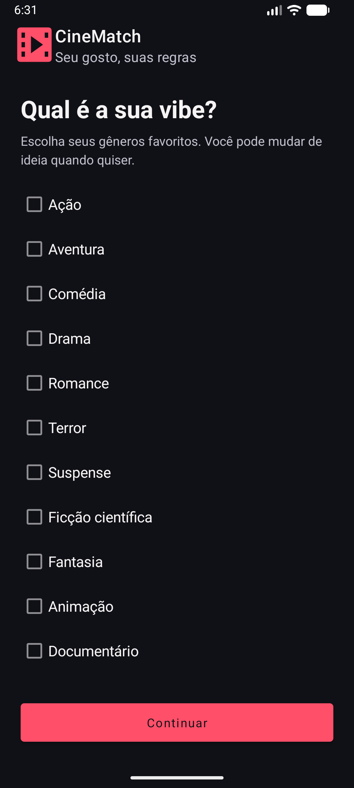
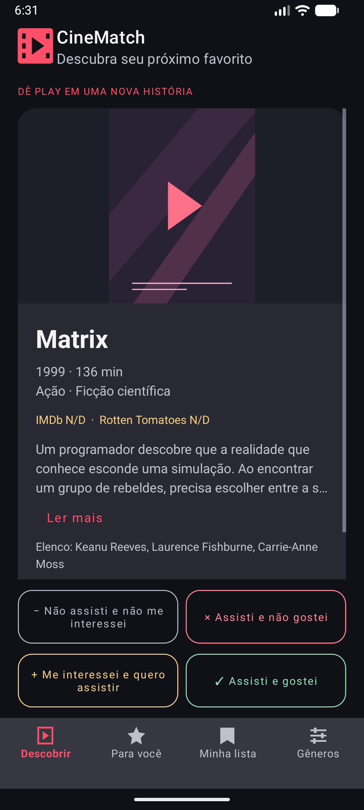
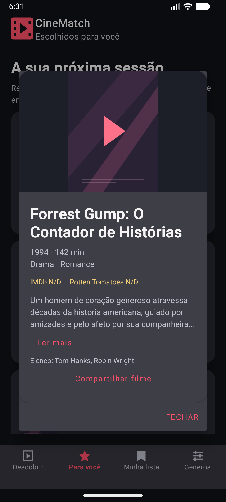

# CineMatch

Um encontro com seu próximo filme favorito. Aplicativo Android nativo de descoberta de filmes, com avaliações em quatro estados, lista pessoal e recomendações explicáveis. Projeto para a AP2 de Desenvolvimento Mobile.

O usuário informa seu nome, escolhe gêneros e avalia filmes. Todos os dados do domínio são persistidos pela API; o Android guarda somente o identificador do perfil e o estado de conclusão do cadastro. O histórico permite transformar um “quero assistir” em “gostei”, ou excluir uma avaliação.

## Executar no Windows

Requisitos: Python 3.12+, Android Studio, Android SDK 37, Build Tools 36.0.0, JDK compatível com Gradle 9.6 e acesso à internet na primeira instalação. Android mínimo: 8.0/API 26. O JDK 25 incluído no Android Studio deste computador foi usado na validação. As dependências Python estão fixadas em `backend/requirements.lock.txt`.

```powershell
cd D:\movie-match
.\setup.ps1
# Se Python não estiver no PATH: .\setup.ps1 -Python 'C:\caminho\python.exe'
.\start-backend.ps1
```

Mantenha o terminal da API aberto. A base `backend/cinematch.db` e o catálogo são criados automaticamente no primeiro início. Reiniciar a API preserva usuários, preferências e avaliações. Não apague esse arquivo para uma apresentação com dados salvos.

- [Swagger local](http://localhost:8000/docs)
- [OpenAPI JSON](http://localhost:8000/openapi.json)
- [Saúde da API](http://localhost:8000/health)

No Android Studio, abra **`D:\movie-match\android`**, aguarde o Gradle Sync, selecione o emulador e execute `app`. Não abra somente a pasta raiz como projeto Android. O Gradle Wrapper está incluído. Configure o SDK em `android/local.properties`, criado automaticamente pelo Android Studio; esse arquivo não vai para o Git.

Pelo PowerShell:

```powershell
cd D:\movie-match\android
.\build.ps1
# APK: app\build\outputs\apk\debug\app-debug.apk
# Com platform-tools no PATH:
adb install -r app\build\outputs\apk\debug\app-debug.apk
```

O emulador padrão usa `http://10.0.2.2:8000/` para acessar o Windows. `localhost` no Android representa o próprio dispositivo. A URL está centralizada em `BuildConfig.API_BASE_URL` e pode ser substituída:

```powershell
.\build.ps1 -ApiBaseUrl 'http://127.0.0.1:8000/'
adb reverse tcp:8000 tcp:8000
```

Esse segundo modo funciona em dispositivo físico USB com depuração autorizada. Outra opção é compilar com `http://IP-DO-WINDOWS:8000/`, na mesma rede, e permitir a porta no firewall manualmente se necessário. HTTP é permitido apenas no manifesto **debug**. Uma distribuição release precisa de API HTTPS e URL configurada por `-PAPI_BASE_URL=https://.../`.

## Telas e navegação

| Activity | Comportamento |
|---|---|
| MainActivity | Nome, cadastro via API e recuperação do ID salvo. Um perfil existente não é recriado ao reabrir. |
| PreferencesActivity | CheckBoxes de múltipla seleção, leitura e atualização de gêneros via API. |
| DiscoveryActivity | Um filme por vez, sinopse expansível, elenco, duração, notas, compartilhamento e quatro avaliações. |
| RecommendationsActivity | RecyclerView com recomendações reais e motivos calculados no backend; detalhes em diálogo. |
| HistoryActivity | RecyclerView agrupada/filtrada por status, lista “quero assistir”, alteração e exclusão. |

As Intents **explícitas** estão em `ui/BaseActivity.kt`, `MainActivity.kt` e `PreferencesActivity.kt`. A Intent **implícita** `ACTION_SEND`, envolvida por `Intent.createChooser`, está em `ui/MovieViews.kt`, no botão “Compartilhar filme”. O app não envia o compartilhamento automaticamente.

Views utilizadas: TextView, TextInputEditText/EditText, MaterialButton/Button, ImageView, MaterialCheckBox/CheckBox, RecyclerView, ProgressBar, MaterialCardView, Spinner e ScrollView. O tema é escuro com vermelho cinematográfico. As ações têm textos/símbolos e cores próprias: cinza, vermelho, dourado e verde. Há feedback de carregamento, erros com nova tentativa, confirmação após resposta da API e estados vazios.

## API REST

| Método | Caminho | Função |
|---|---|---|
| GET | `/health` | Verifica API e conexão com banco |
| POST | `/users` | Cadastra nome |
| GET / PATCH | `/users/{id}` | Consulta/altera perfil |
| GET | `/genres` | Lista 11 gêneros |
| GET / PUT | `/users/{id}/preferences` | Lê/substitui preferências |
| GET | `/movies` | Catálogo paginado com offset/limit |
| GET | `/movies/discovery?user_id=1` | Filmes ainda não avaliados |
| GET | `/movies/{id}` | Detalhes |
| POST | `/evaluations` | Registra avaliação (duplicação retorna 409) |
| GET | `/users/{id}/evaluations?status=GOSTEI` | Histórico, filtro opcional |
| PATCH / DELETE | `/evaluations/{id}?user_id=1` | Altera/exclui avaliação do perfil informado |
| GET | `/users/{id}/watchlist` | Lista “quero assistir” |
| GET | `/users/{id}/recommendations` | Recomendações calculadas |

Exemplos para o Swagger:

```json
{"name": "Ana"}
```

```json
{"genre_ids": [1, 8]}
```

```json
{"user_id": 1, "movie_id": 1, "status": "GOSTEI"}
```

Os outros status são `QUERO_ASSISTIR`, `NAO_GOSTEI`, `SEM_INTERESSE`. Entradas inválidas retornam 422, registros ausentes 404, duplicação 409 e exclusão bem-sucedida 204. `user_id` delimita operações ao perfil informado, mas **não é autenticação**. Esta versão é para demonstração local; acesso público exigiria autenticação e autorização reais.

## Recomendações

Cada gênero selecionado recebe +3. Cada avaliação soma aos gêneros do filme: `GOSTEI` +5, `QUERO_ASSISTIR` +2, `NAO_GOSTEI` −4, `SEM_INTERESSE` −1. A pontuação de um candidato é a **média dos pesos dos seus gêneros**. Isso evita favorecer um filme só por possuir mais gêneros.

Todos os filmes já avaliados são excluídos, inclusive os desejados. Maior média vem primeiro; ID crescente desempata. Não há porcentagem de compatibilidade nem machine learning. As explicações mencionam somente gêneros com peso realmente positivo. Sem afinidade positiva, o retorno informa que é uma alternativa do catálogo. Sem histórico ou preferências, informa que é sugestão inicial. Sem candidatos, retorna lista vazia. Alterar ou excluir uma avaliação muda o cálculo na próxima consulta.

## Catálogo e OMDb

O catálogo inicial tem **20 filmes reais** e 11 gêneros, com sinopses editoriais próprias, dados de identificação, duração e elenco. É um conjunto reduzido para demonstração sem credenciais externas. Os links das fichas estão em [docs/catalog-sources.md](docs/catalog-sources.md). A categorização em gêneros é editorial. Não se embutiram cartazes de terceiros nem notas sem uma fonte configurada: nesses campos o app usa uma ilustração vetorial original e “N/D”.

Enriquecimento opcional:

```powershell
cd D:\movie-match\backend
Copy-Item .env.example .env
# Edite .env localmente: OMDB_API_KEY=sua_chave
..\.venv\Scripts\python.exe -m app.enrich
```

O comando consulta a [OMDb](https://www.omdbapi.com/), salva cartaz, duração, elenco e notas disponíveis e preserva título/sinopse em português. Sem a chave, ou se a OMDb falhar, a persistência e a recomendação continuam funcionando. O enriquecimento é um comando local, sem endpoint público de administração. Não imprime URLs com a chave em erros. Imagens ainda exigem rede para baixar no dispositivo.

Os dados/imagens enriquecidos são fornecidos pela OMDb; respeite os [termos e atribuição indicados pelo serviço](https://www.omdbapi.com/). A Poster API dedicada é uma oferta separada; o código usa apenas o campo `Poster` retornado pela API de metadados. A chave fica exclusivamente no backend e `.env` está no `.gitignore`.

## Organização

```text
movie-match/
  android/                 Projeto Android completo e Gradle Wrapper
    app/src/main/          Activities, XML, dados/Retrofit e recursos
    app/src/debug/         HTTP somente no ambiente de desenvolvimento
    app/src/androidTest/   Teste de fluxo com backend real
  backend/
    app/                   FastAPI, modelos, schemas, catálogo e recomendação
    tests/                 Testes Pytest isolados em SQLite temporário
  docs/                    Arquitetura, apresentação, fontes e validação
    screenshots/           Capturas reais geradas nos testes
  setup.ps1
  start-backend.ps1
```

Tecnologias: Kotlin/XML, AndroidX, Material Components, ViewBinding, Coroutines/Lifecycle, Retrofit/Gson/OkHttp, Coil; Python, FastAPI, Pydantic, SQLAlchemy, SQLite, Uvicorn e Pytest. A [arquitetura](docs/architecture.md) detalha tabelas e responsabilidades. As versões AGP/Gradle foram escolhidas pela [matriz oficial de compatibilidade](https://developer.android.com/build/releases/agp-9-4-0-release-notes); o AGP 9 usa [Kotlin integrado](https://developer.android.com/build/migrate-to-built-in-kotlin).

## Testes e evidências

```powershell
cd D:\movie-match\backend
..\.venv\Scripts\python.exe -m pytest -q
cd ..\android
.\gradlew.bat assembleDebug lintDebug
# Emulador iniciado e API ligada na porta 8000:
.\gradlew.bat connectedDebugAndroidTest
```

O teste Android cria um perfil demonstrativo e avaliações na API ligada; use uma base de demonstração. Verifica cadastro, preferências, quatro status, exclusão de avaliados das recomendações, navegação, compartilhamento, alteração, exclusão e recuperação do perfil ao relançar a tela inicial. Resultados efetivamente obtidos, limitações e checklist AP2 estão em [docs/validation.md](docs/validation.md). Consulte também o [roteiro de apresentação](docs/presentation.md).

Capturas reais do emulador Android:

| Início | Gêneros | Descoberta |
|---|---|---|
|  |  |  |

| Recomendações | Minha lista | Detalhes e compartilhamento |
|---|---|---|
|  |  |  |

## GitHub

O projeto está preparado para Git, com `.env`, banco local, caches, SDK local e builds ignorados. Para publicar em um repositório dedicado depois de revisar o conteúdo:

```powershell
cd D:\movie-match
git remote add origin https://github.com/SEU-USUARIO/cinematch.git
git push -u origin main
```

A publicação pública precisa ser feita/autorizada pelo proprietário. Nenhuma URL pública deve ser considerada existente antes da publicação.

## Limitações

- Perfil sem senha: a identidade é o ID salvo neste dispositivo. Não é um sistema multiusuário autenticado.
- A API precisa estar acessível para usar catálogo e histórico. O catálogo dispensa OMDb, mas o app depende do próprio backend.
- Não há migrações automáticas de esquema, importação de catálogo arbitrário, login ou sincronização de perfil entre dispositivos.
- O catálogo editorial é pequeno; ao avaliar todos os filmes, não existem novas recomendações até rever/excluir avaliações.
- Cartazes/notas reais dependem da chave OMDb e de dados disponíveis para cada título. O enriquecimento externo tem validação automatizada de parsing, mas requer chave para teste real.
- A compreensão do código e a apresentação individual são responsabilidade de quem apresenta. Estude o roteiro e faça a demonstração antes da entrega.
