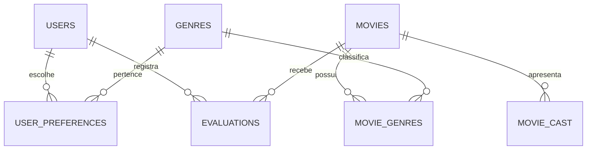

# Arquitetura do CineMatch

Fluxo: **Activity/XML → Repository/Retrofit → HTTP JSON → FastAPI/Pydantic → SQLAlchemy → SQLite**. A resposta percorre o caminho inverso. Não há acesso Android direto ao banco. Imagens opcionais são carregadas com Coil e têm fallback vetorial original.

## Android

`data/Models.kt` contém os contratos JSON, `Api.kt` centraliza endpoints e cliente de rede, e `Profile.kt` guarda o ID. As cinco Activities cuidam dos respectivos formulários/listas. `BaseActivity` compartilha navegação, insets, indicador de carregamento e tratamento de erro; `MovieViews` compartilha detalhes e Intent implícita; `MovieAdapter` cuida das linhas de RecyclerView. As requisições são `suspend`, executadas em `lifecycleScope`, e canceladas quando a Activity é destruída.

O app bloqueia ações durante uma requisição. Ao salvar uma avaliação, só avança quando o servidor confirma. Se o carregamento do próximo filme falhar depois de salvar, a nova tentativa apenas carrega o catálogo, sem reenviar a avaliação já confirmada. O banco também impõe unicidade por usuário/filme. Em caso de resposta perdida após commit, uma repetição retorna 409; o usuário pode navegar de volta à descoberta ou editar pelo histórico.

No retorno a descoberta, recomendações e histórico, `onResume` consulta a API novamente. O histórico usa a resposta completa do perfil para filtrar status localmente, preservando o backend como fonte de verdade. A lista desejada é o filtro `QUERO_ASSISTIR`, também exposto em endpoint próprio.

## Backend

- `database.py`: engine, sessões curtas, `.env` e habilitação de chaves estrangeiras do SQLite.
- `models.py`: tabelas, relacionamentos e restrições de integridade.
- `schemas.py`: validação de entrada e serialização das respostas.
- `catalog.py`: seed idempotente; reiniciar não duplica nem substitui dados enriquecidos.
- `recommendations.py`: algoritmo determinístico, independente da UI e da OMDb.
- `main.py`: endpoints e transações; ordem de rotas evita conflito de `/movies/discovery` com IDs.
- `enrich.py`: importação opcional da OMDb por comando local.

O projeto tem poucas entidades, por isso usa módulos de responsabilidade única em vez de várias camadas de classes vazias. Os modelos Pydantic impedem status inválidos; restrições SQL impedem duplicações e referências inválidas. Erros FastAPI usam JSON com `detail`.

## Banco relacional

| Tabela | Chave e relacionamentos |
|---|---|
| users | id, name, created_at |
| movies | id; imdb_id único; metadados e notas opcionais |
| genres | id; name único |
| movie_genres | chave composta movie_id/genre_id e duas FKs |
| movie_cast | chave composta movie_id/cast_order; FK para movie |
| user_preferences | chave composta user_id/genre_id e duas FKs |
| evaluations | id; FKs user_id/movie_id; unicidade do par; CHECK dos quatro status |

Cada POST/PATCH/PUT/DELETE confirma uma transação. As sessões são fechadas ao concluir a requisição. O arquivo SQLite fica no diretório de trabalho do backend, salvo se `DATABASE_URL` substituir o caminho. O script raiz sempre inicia no diretório `backend` para evitar bancos acidentais em pastas diferentes.

## Explicabilidade

Peso do gênero = 3 se preferido + soma dos pesos dos status de filmes avaliados que contêm esse gênero. Pontuação do filme = soma dos pesos dos seus gêneros / quantidade de gêneros. Ordenação decrescente por pontuação e crescente por ID. As notas IMDb/RT são exibidas, mas não influenciam a recomendação. Alterações são refletidas imediatamente porque a pontuação é calculada a cada consulta.

Sem autenticação, o `user_id` informado não comprova identidade. Esta implementação foi limitada à apresentação local. Não publicar esta API aberta na internet sem uma camada de autenticação/autorização e configuração adequada de produção.
