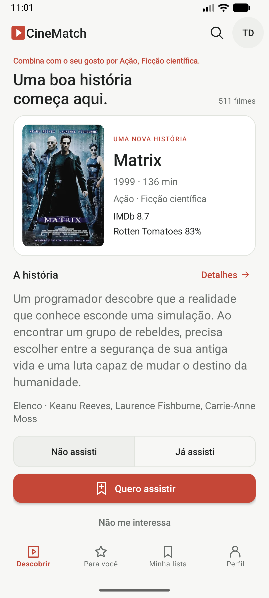
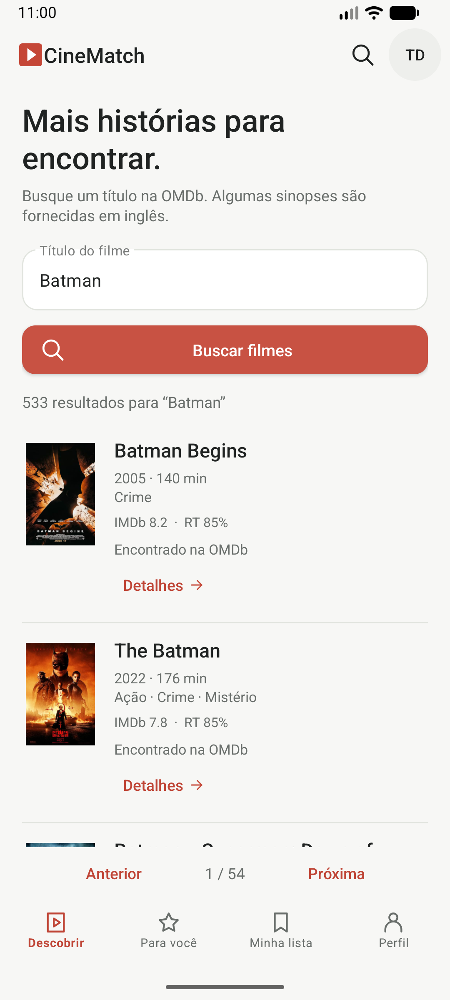

# Interface ampliada e catálogo real — versão 3.1

## Checkpoint publicado antes das alterações

Conforme solicitado, a versão anterior foi primeiro commitada e enviada ao GitHub:
[`b99b104`](https://github.com/brnpessoa14/movie-match/commit/b99b104879e5da8f34b94025931315c683c95f19).
Somente depois foram feitas as mudanças desta versão 3.1. A versão 3.1 foi posteriormente preparada para publicação no GitHub por solicitação do proprietário, preservando o checkpoint anterior.

## O que mudou

- A descoberta aumenta cartaz, título (26 sp), metadados (14–15 sp) e sinopse (18 sp) quando há altura suficiente. Mostra o elenco e separa IMDb/Rotten Tomatoes. Mede o conteúdo disponível e adapta as linhas da sinopse; a composição compacta permanece disponível para títulos longos, horizontal e fonte ampliada. Detalhes completos continuam no diálogo.
- O seed original de 20 filmes foi mantido. A importação real da OMDb adicionou 482 filmes e chegou a 502, com 529 consultas. Buscas posteriores também podem ampliar o cache.
- Estado observado na entrega: **511 filmes**, 510 com URL de cartaz, 45 páginas de busca em cache. Foram registradas 539 consultas OMDb nesta implementação, incluindo importação e validação da busca. Consultas anteriores à implementação do contador não estão incluídas.
- A lupa no cabeçalho abre a busca por título na OMDb, com páginas de resultados e consulta de detalhes. Resultados e fichas ficam no SQLite; a mesma busca usa o cache por sete dias. A API limita páginas ao intervalo suportado pela OMDb (1–100).
- Descoberta e Para você usam os pesos reais de preferências e avaliações. A descoberta deixa de ordenar simplesmente por ID. Após cada avaliação confirmada, consulta novamente a fila calculada; mudar apenas o seletor não registra avaliação. O contador informa todos os candidatos ainda não avaliados da conta, independentemente do lote de 20 recebido.
- Se a avaliação falha, o filme não avança. Se o POST confirma mas a atualização da fila falha, a nova tentativa apenas recarrega; não duplica o POST. A busca externa informa falhas reais e mantém o catálogo já salvo.

## Verificação executada

- Backend: **20 testes passaram**. Incluem importação idempotente, cache entre sessões, preservação dos filmes existentes, validação/autorização da busca, falha real do provedor, mudança na ordem por preferências/avaliações e novos candidatos para conta que esgotou os 20 originais. Um aviso de depreciação Starlette/httpx permanece.
- Android: **5 testes principais passaram** no APK 3.1 instalado. Incluem conta/sessão, edição, temas, avaliações, toques duplicados, erros sem avanço, detalhes, compartilhamento e busca real na OMDb com cache.
- **3 testes adicionais passaram**: compacto 360×640 dp, horizontal 853×533 dp e compacto com fonte em 200%. Resolução e fonte foram restauradas depois.
- `assembleDebug`, `assembleDebugAndroidTest` e `lintDebug`: concluídos; lint com **0 erros e 71 avisos**, sem baseline para ocultar falhas.
- Todos os registros anteriores comparados com o backup foram preservados em users, accounts, movies, genres, movie_genres, movie_cast, user_preferences e evaluations. Contas criadas pelos testes são adicionais.
- APK: `android/app/build/outputs/apk/debug/app-debug.apk`; versionCode 4, versionName 3.1. SHA-256: `3b1ccfc42f8073e6aec27a138db79de37be1867e35bd3612cba057081612488b`.
- Evidências textuais da rodada final: `.tools/validation-expanded/` (ignorado pelo Git).

## Capturas reais

As versões clara/escura, compacta, horizontal e com fonte ampliada estão na mesma pasta.

## Limites e fonte

A [OMDb](https://www.omdbapi.com/) oferece busca por título e fichas, não um endpoint de descoberta por gênero. O banco local não contém todo o acervo da OMDb: a busca consulta o provedor e adiciona os filmes encontrados. A ordenação personalizada é calculada pelo CineMatch, por gêneros e avaliações; não há modelo de linguagem nem porcentagens inventadas.

Títulos e sinopses importados permanecem no idioma fornecido pela OMDb, geralmente inglês. Os títulos e sinopses editoriais em português dos 20 filmes originais foram preservados. O cadastro de novos filmes depende da disponibilidade e cota da chave; o catálogo já salvo funciona sem novas consultas ao provedor. Imagens e notas ausentes usam os fallbacks existentes.

Validação em emulador API 37 e API local. Celular físico, Play Store e hospedagem externa não foram testados. A API foi deixada ativa e o aplicativo no login.
