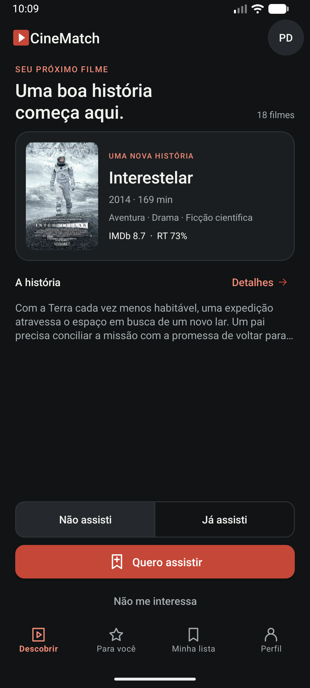
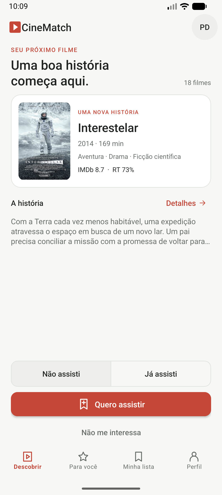
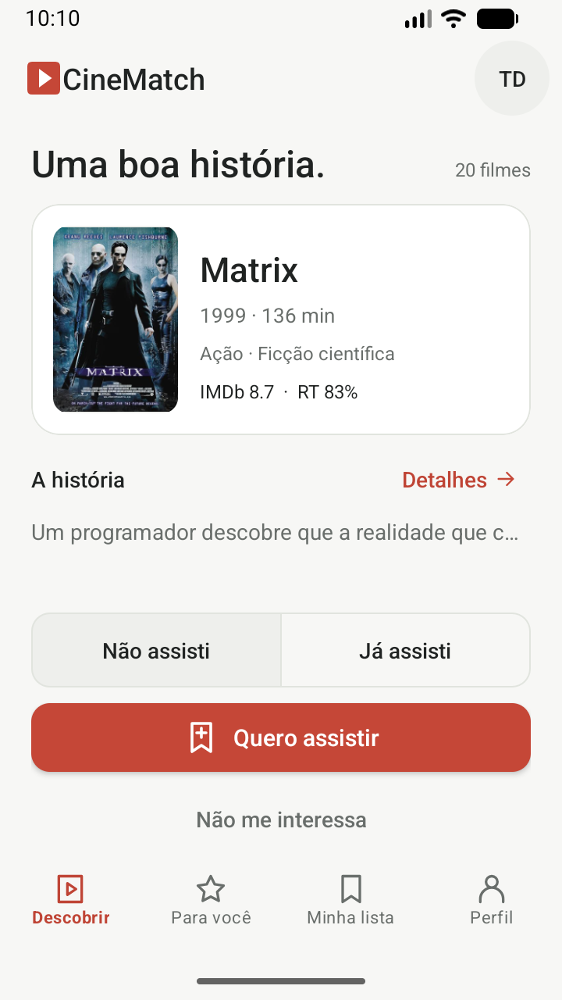
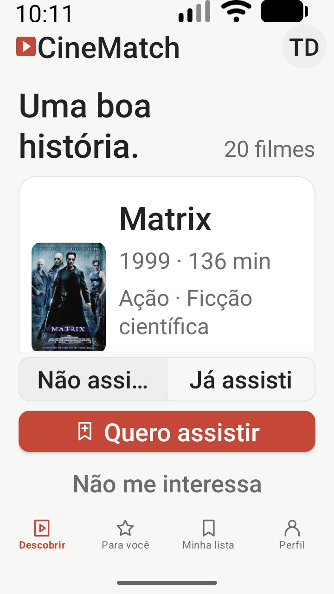
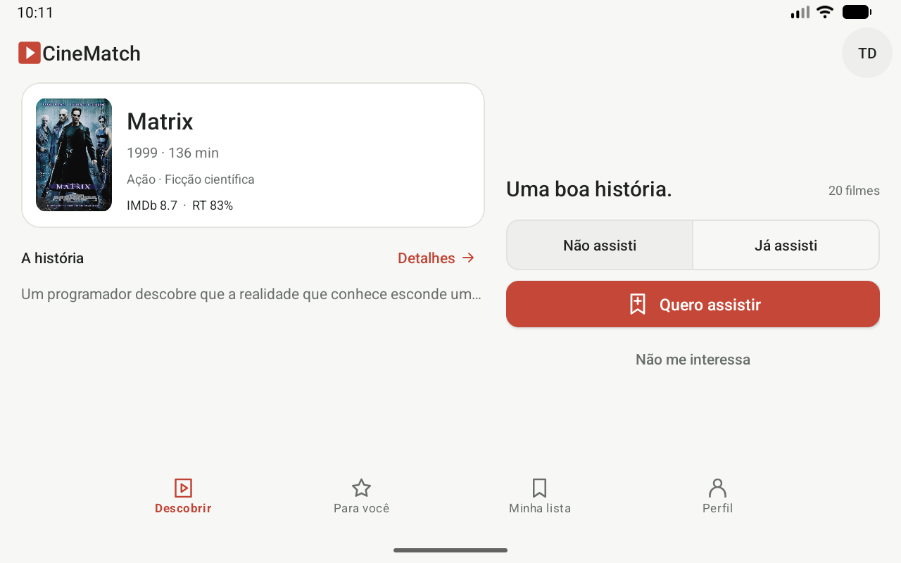

# Validação da interface Banner — 14/11/2026

Versão **3.0-banner**, versionCode **3**, Android nativo Kotlin/XML, FastAPI/SQLite.
APK compilado: `android/app/build/outputs/apk/debug/app-debug.apk`.
SHA-256: `942a9cc3f76ef4f4d1d6aaf777bdaa87464ed19ef6591c328020de161e4f638b`.

## Verificações executadas

- `assembleDebug`, `assembleDebugAndroidTest` e `lintDebug`: concluídos. Lint: **0 erros e 63 avisos**; não foi criada baseline nem suprimida a verificação.
- Backend: **16 testes Pytest passaram**. Um aviso de depreciação de Starlette/httpx permanece.
- Android, rodada final no emulador API 37: **4 testes passaram**. Cadastro/login, isolamento, quatro avaliações e seus estados, seletor sem gravação, avanço após confirmação, bloqueio de toque duplicado, erro real sem avanço, nova tentativa, edição de conta, persistência de usuário, gêneros, temas, logout e login ao retornar; navegação, filtros, edição/remoção, detalhes e Intent de compartilhamento.
- Testes adicionais de responsividade: **3 passaram**, em 360×640 dp, horizontal 853×533 dp e tela compacta com fonte em 200%.
- Verificação adicional de todos os **20 títulos do catálogo em tela compacta**: passou. Sem rolagem na descoberta em fonte normal; título/subtítulo legíveis. Fontes ampliadas podem rolar apenas a área do filme, mantendo ações e navegação acessíveis.
- Comparação do banco com o backup anterior à interface: preservados todos os registros anteriores de users (19), accounts (12), movies (20), genres (11), movie_genres (52), movie_cast (60), user_preferences (31) e evaluations (32). Testes criaram contas próprias na API; não alteraram contas anteriores. Sessões são transitórias e não fazem parte dessa comparação.
- API local `/health`: respondeu `{"status":"ok"}`.

Os testes Android foram executados com `adb shell am instrument -w`, usando o APK instalado e a API real. A saída da rodada final está em `.tools/validation-banner/` (arquivos locais ignorados pelo Git). Não houve novas consultas à OMDb.

## Execução e correções

O AVD anterior não estava mais registrado no Device Manager. Foi criado **CineMatch_Banner_API_37** separadamente com a imagem oficial já instalada, preservando os arquivos do AVD anterior. A configuração nova usa renderização SwiftShader e inicialização fria, como na execução validada. Resolução e fonte foram restauradas ao padrão no fim dos testes.

Foi corrigido um bloqueio da navegação durante consultas: após voltar do compartilhamento, o toque em Minha lista podia ser ignorado enquanto as recomendações recarregavam. A navegação agora continua disponível. Os controles de avaliação continuam bloqueados durante o envio para impedir duplicações.

Para executar no Android Studio, abra **D:\movie-match\android**, aguarde o Gradle Sync, escolha `app` e **CineMatch_Banner_API_37**, e pressione Run. Abrir o emulador pelo Device Manager inicia o Android; o Run instala o código atual. A API precisa estar ativa; para iniciá-la novamente, use `start-backend.ps1` na raiz.

## Capturas reais

| Descoberta escura | Descoberta clara |
|---|---|
|  |  |

| Compacto | Fonte em 200% |
|---|---|
|  |  |

As capturas de perfil, recomendações e lista estão na mesma pasta. Os nomes e usuários mostrados são contas de teste criadas pelos testes.

## Limites concretos

Validação executada em emulador Android API 37 neste computador. Celular físico, Play Store e hospedagem externa não foram testados. O APK debug usa HTTP local; uma distribuição externa exige configuração de produção com HTTPS. Não houve commit, push, merge ou alteração do site de referência nesta evolução.
